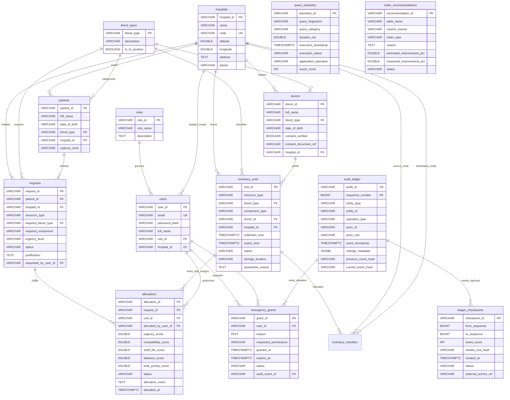

# LIFELINK RELATIONAL SCHEMA, ER DIAGRAM & NORMALIZATION SPECIFICATION

**Student Developer:** Arsh Vardhan Singh (Registration Number: 24BCE2119)  
**Institutional Context:** School of Computer Science and Engineering, Vellore Institute of Technology (VIT)  
**Course Context:** Database Systems Lab  
**Project Identifier:** `LIFELINK_24BCE2119`  

---

## 1. Complete Entity-Relationship (ER) Diagram

---

## 2. Functional Dependencies & Relational Normalization Proof

### A. Functional Dependencies (FDs) Analysis

1. **`users` Table:**
   - $FD_1: \text{user\_id} \to \{\text{email}, \text{password\_hash}, \text{full\_name}, \text{role\_id}, \text{hospital\_id}, \text{is\_active}\}$
   - $FD_2: \text{email} \to \{\text{user\_id}, \text{password\_hash}, \text{full\_name}, \text{role\_id}, \text{hospital\_id}, \text{is\_active}\}$
   - **Candidate Keys:** $\{\text{user\_id}\}, \{\text{email}\}$

2. **`hospitals` Table:**
   - $FD_1: \text{hospital\_id} \to \{\text{name}, \text{code}, \text{latitude}, \text{longitude}, \text{address}, \text{phone}\}$
   - $FD_2: \text{code} \to \{\text{hospital\_id}, \text{name}, \text{latitude}, \text{longitude}, \text{address}, \text{phone}\}$
   - **Candidate Keys:** $\{\text{hospital\_id}\}, \{\text{code}\}$

3. **`inventory_units` Table:**
   - $FD_1: \text{unit\_id} \to \{\text{resource\_type}, \text{blood\_type}, \text{component\_type}, \text{donor\_id}, \text{hospital\_id}, \text{collection\_time}, \text{expiry\_time}, \text{status}, \text{storage\_location}, \text{quarantine\_reason}\}$
   - **Candidate Key:** $\{\text{unit\_id}\}$

4. **`allocations` Table:**
   - $FD_1: \text{allocation\_id} \to \{\text{request\_id}, \text{unit\_id}, \text{allocated\_by\_user\_id}, \text{urgency\_score}, \text{compatibility\_score}, \text{shelf\_life\_score}, \text{distance\_score}, \text{total\_priority\_score}, \text{status}, \text{allocated\_at}\}$
   - **Candidate Key:** $\{\text{allocation\_id}\}$

5. **`audit_ledger` Table:**
   - $FD_1: \text{sequence\_number} \to \{\text{audit\_id}, \text{entity\_type}, \text{entity\_id}, \text{operation\_type}, \text{actor\_id}, \text{actor\_role}, \text{event\_timestamp}, \text{change\_metadata}, \text{previous\_event\_hash}, \text{current\_event\_hash}\}$
   - $FD_2: \text{audit\_id} \to \{\text{sequence\_number}, \text{current\_event\_hash}, \dots\}$
   - **Candidate Keys:** $\{\text{sequence\_number}\}, \{\text{audit\_id}\}$

---

### B. Normal Form Verification (1NF to BCNF)

#### First Normal Form (1NF)
- **Criterion:** All attributes contain atomic, indivisible values; no repeating groups or multivalued arrays.
- **Verification:** In LifeLink, composite fields like addresses and coordinates are decomposed into scalar datatypes (`latitude`, `longitude`, `address`). The compatibility matrix is stored relationally through distinct foreign key tuples rather than serialized string lists in rows. 1NF is strictly satisfied.

#### Second Normal Form (2NF)
- **Criterion:** Relation is in 1NF, and no non-prime attribute is partially dependent on any proper subset of a composite candidate key.
- **Verification:** All primary keys across core tables are single-attribute surrogate keys (`unit_id`, `request_id`, `allocation_id`, `user_id`). Since no composite primary keys exist, partial functional dependency is mathematically impossible. Therefore, every table is in 2NF.

#### Third Normal Form (3NF)
- **Criterion:** Relation is in 2NF, and for every non-trivial functional dependency $X \to Y$, either $X$ is a superkey, or $Y$ is a prime attribute (no transitive dependencies $A \to B \to C$).
- **Verification:**
  - Notice that in `users`, `hospital_name` and `hospital_address` are **not** stored in `users`. Storing `hospital_id \to hospital_name` inside `users` would create a transitive dependency ($\text{user\_id} \to \text{hospital\_id} \to \text{hospital\_name}$). By factoring `hospitals` into an independent relation, transitive dependencies are completely eliminated.
  - Similarly, `blood_type` descriptions are not embedded in `patients` or `inventory_units`. 3NF is strictly satisfied.

#### Boyce-Codd Normal Form (BCNF)
- **Criterion:** For every non-trivial functional dependency $X \to Y$, $X$ must be a superkey.
- **Verification:** In all relations, the left-hand side of every dependency is a candidate key ($\{\text{user\_id}\}$, $\{\text{email}\}$, $\{\text{code}\}$, $\{\text{unit\_id}\}$, etc.). There are no overlapping candidate keys with non-trivial dependencies from non-superkeys. Hence, the relational design is in BCNF.

---

### C. Concrete Decomposition Example: Decomposing a Denormalized Table

Consider a naïve denormalized intake table:
$$\text{UNNORMALIZED\_ALLOCATION}(\underline{\text{alloc\_id}}, \text{req\_id}, \text{unit\_id}, \text{patient\_name}, \text{patient\_blood}, \text{donor\_name}, \text{hosp\_name}, \text{hosp\_lat}, \text{hosp\_lon})$$

**Anomalies Present in Denormalized Design:**
1. **Redundancy:** Hospital name and geographic coordinates are duplicated across every allocation created by that medical center.
2. **Update Anomaly:** Updating a hospital's phone or coordinates requires modifying hundreds of allocation rows; failing to update all causes data inconsistency.
3. **Deletion Anomaly:** Deleting a cancelled allocation destroys the historical record of the hospital if that was its only allocated unit.

**Lossless Join & Dependency-Preserving Decomposition:**
We apply projection decomposition:
1. $R_1(\underline{\text{hospital\_id}}, \text{name}, \text{code}, \text{latitude}, \text{longitude}, \text{address}, \text{phone})$
2. $R_2(\underline{\text{patient\_id}}, \text{full\_name}, \text{blood\_type}, \text{hospital\_id})$
3. $R_3(\underline{\text{donor\_id}}, \text{full\_name}, \text{blood\_type}, \text{hospital\_id})$
4. $R_4(\underline{\text{unit\_id}}, \text{resource\_type}, \text{blood\_type}, \text{donor\_id}, \text{hospital\_id})$
5. $R_5(\underline{\text{request\_id}}, \text{patient\_id}, \text{hospital\_id}, \text{required\_blood\_type})$
6. $R_6(\underline{\text{allocation\_id}}, \text{request\_id}, \text{unit\_id}, \text{allocated\_by\_user\_id}, \text{scores}\dots)$

The natural join $R_1 \bowtie R_2 \bowtie R_3 \bowtie R_4 \bowtie R_5 \bowtie R_6$ losslessly reconstructs the original relation because every join occurs on a candidate superkey.

---

### D. Donor Availability Multivalued Dependency (MVD) & 4NF Analysis

**The Multivalued Dependency Problem:**
Suppose a donor entity simultaneously recorded:
1. Multiple preferred contact phone numbers: $\text{donor\_id} \twoheadrightarrow \text{phone\_number}$
2. Multiple organ donation consent categories: $\text{donor\_id} \twoheadrightarrow \text{organ\_type}$

If both independent multivalued attributes were combined into a single table:
$$\text{DONOR\_ATTRIBUTES}(\underline{\text{donor\_id}, \text{phone\_number}, \text{organ\_type}})$$
A donor with 2 phone numbers and 3 consented organs would require $2 \times 3 = 6$ cartesian product rows. Inserting a new phone number would require inserting 3 rows, creating a 4NF violation.

**LifeLink 4NF Architectural Decision:**
In LifeLink, donors record consent at the single legal document reference level (`consent_document_ref`), while discrete physical organs are represented as individual inventory units (`inventory_units.resource_type = 'ORGAN'`). Independent multivalued sets are decomposed into distinct entity boundaries, preventing cartesian row expansion and guaranteeing Fourth Normal Form (4NF) compliance.
